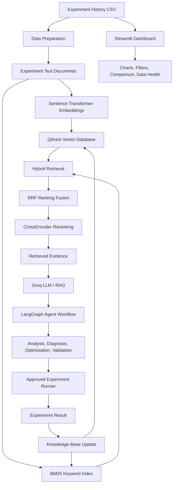

# ExperimentIQ
### Agentic RAG-Based ML Experiment Failure Analysis & Optimization Platform

ExperimentIQ is an academic prototype designed to help machine-learning practitioners search, compare, and analyze historical ML experiments. It combines hybrid retrieval, evidence-grounded LLM explanations, experiment-analysis workflows, and a Streamlit dashboard.

> **Project status:** Prototype. The Streamlit dashboard's CSV exploration and keyword search can work independently. Full integration with the semantic RAG pipeline and end-to-end agent execution must be connected and tested in the target environment. Recommendations do not guarantee better model performance.

## Overview
ML development often involves many experiments with different algorithms, preprocessing steps, and hyperparameters. ExperimentIQ organizes experiment history and helps users find relevant runs, compare metrics, investigate recorded failure patterns, and plan candidate follow-up experiments.

## Problem Statement
- Tracking experiment configurations and results manually can be difficult.
- Finding similar historical experiments takes time.
- Comparing model metrics consistently is important.
- Failure investigation can require reviewing many earlier runs.
- Historical experiment knowledge can be difficult to reuse.

**Goal:** make experiment history searchable and useful for evidence-based ML-development decisions.

## Key Features
- Read experiment history from CSV.
- Convert experiment records into text documents.
- Generate embeddings with Sentence Transformers (`all-MiniLM-L6-v2`).
- Store/search vectors with Qdrant.
- Combine semantic retrieval and BM25 keyword search.
- Fuse rankings with Reciprocal Rank Fusion (RRF).
- Rerank retrieved candidates with a CrossEncoder.
- Use a Groq-hosted LLM for evidence-grounded explanations when configured.
- Organize retrieval, analysis, diagnosis, optimization, validation, comparison, and lineage tasks with LangGraph.
- Compare R², MAE, RMSE, and training time.
- Validate candidate configurations before controlled execution.
- Update retrieval knowledge after a successful experiment.
- Explore history, compare runs, review failure records, and check data quality in Streamlit.

## Architecture



## Tech Stack

| Category | Technologies |
|---|---|
| Language | Python |
| Data processing | Pandas, NumPy |
| Machine learning | Scikit-learn |
| Embeddings | Sentence Transformers |
| Vector database | Qdrant |
| Keyword retrieval | BM25 (`rank-bm25`) |
| Ranking fusion | Reciprocal Rank Fusion (RRF) |
| Reranking | CrossEncoder |
| LLM integration | Groq API |
| Agent orchestration | LangGraph |
| Dashboard | Streamlit |
| Visualization | Plotly |
| Data formats | CSV, JSON, NPY |

## Screenshots


## Getting Started

### Prerequisites
- Python 3.10 or a version compatible with your installed dependencies.
- pip.
- A local copy of the experiment history CSV.
- Groq API key only if you run LLM-powered functionality.

### 4. Run the dashboard

```bash
python -m streamlit run app.py
```

## Configuration and API Security

If using Groq, store the API key in an environment variable rather than in source code.

**Windows Command Prompt:**
```bat
set GROQ_API_KEY=your_api_key_here
```

**PowerShell:**
```powershell
$env:GROQ_API_KEY="your_api_key_here"
```

Never commit real API keys, passwords, tokens, or private credentials. Revoke and rotate any secret accidentally committed.

## Data Fields

Depending on the CSV schema, experiment records may include `experiment_id`, `timestamp`, `model`, `dataset`, `n_estimators`, `max_depth`, `r2_score`, `mae`, `rmse`, `training_time_sec`, `status`, `failure_reason`, and `parent_experiment_id`.

Clearly label synthetic or demonstration records. Do not present simulated values as real model-training results.

## RAG Workflow
1. Prepare experiment history and create text documents.
2. Generate embeddings with Sentence Transformers.
3. Store vectors and metadata in Qdrant.
4. Retrieve candidates with semantic search and BM25.
5. Combine rankings with RRF.
6. Rerank candidates with a CrossEncoder.
7. Pass retrieved evidence to the LLM for an explanation.
8. After a successful recorded experiment, update documents, vectors, and search indexes.

## Evaluation and Safety
- Use Python/Pandas for exact metric calculations.
- Compare experiments only when datasets, targets, preprocessing, and evaluation splits are comparable.
- Treat retrieval scores as ranking signals, not probabilities or model-performance metrics.
- Treat suggested configurations as candidates that still need evaluation.
- Separate recorded facts from possible explanations.
- Require explicit approval before controlled experiment execution.
- Verify experiment IDs, documents, embeddings, and vector records remain synchronized.

## Current Limitations
- The dashboard currently reads the experiment CSV and provides local keyword search. Full semantic RAG/LLM integration requires connecting the existing notebook functions.
- The dashboard is not itself a complete training orchestration service.
- The example controlled runner covers a Random Forest execution pattern; additional model-specific runners and tests may be needed.
- Basic validation does not guarantee training success or improved metrics.
- Retrieval quality depends on data quality, retrieval settings, and evaluation.

## Future Improvements
- Connect the dashboard to the full RAG and LangGraph workflow.
- Add automated tests for retrieval, ranking, validation, and knowledge updates.
- Add recovery for partial knowledge-base updates.
- Track dataset versions and evaluation split details.
- Evaluate retrieval using Precision@K, Recall@K, MRR, and manually reviewed relevance labels.
- Add model-specific runners and access controls where needed.

## Author

**Shubham Modi**  
Machine Learning · RAG Systems · AI Agents · Data Science

- LinkedIn: https://www.linkedin.com/in/shubhammodi17/

---
**Disclaimer:** ExperimentIQ is an educational/research prototype. Its outputs are decision-support aids, not guarantees of model performance. Verify recommendations with controlled experiments and appropriate evaluation.
